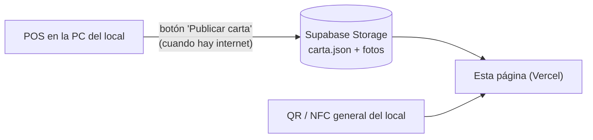

# Carta digital de AKROS Café

Página que abren los clientes al escanear el QR general del local (o acercar el celular a la etiqueta NFC). Es **solo
para ver la carta**: los pedidos los toma el mozo. Es estática (HTML, CSS y JS sin compilar): se publica tal cual en
Vercel y lee la carta de un archivo `carta.json` que publica el POS.



Si el local se queda sin internet, la carta sigue funcionando con la última versión publicada.
Si el que se queda sin señal es el cliente, ve la última carta que abrió en su celular, con un aviso.

## Cómo se ve

- Arriba, el buscador y las **secciones** como pestañas: Desayunos y Meriendas, Cafetería (con Cositas, Bebidas frías y
  Sandwichitos), Almuerzo y Cena (estas dos, "Próximamente"). La confitería no va en la carta: se vende en el mostrador.
- Se abre en la sección **del momento** según la hora de Argentina (marcada "Ahora"); fuera de todo horario, en la primera.
- Cada producto es un renglón de carta: `Cortado ........ $2.500`, la descripción debajo y, si tiene, una foto chica.
- El buscador busca en todas las secciones, sin importar acentos ni mayúsculas.

## Probar en la PC

```bash
npm run dev     # http://localhost:4000
npm test        # pruebas (node --test, sin dependencias)
```

`config.js` dice de dónde se lee la carta: por ahora `carta-ejemplo.json`, después la URL pública de Supabase.

## Formato de `carta.json` (versión 2)

Lo genera el POS: es el contrato entre el POS y esta página. Cambiarlo se avisa antes.

```json
{
  "version": 2,
  "negocio": "AKROS Café",
  "publicadaEn": "2026-10-29T15:00:00.000Z",
  "secciones": [
    {
      "id": "desayuno-merienda",
      "nombre": "Desayuno y Merienda",
      "horarios": [{ "desde": "07:00", "hasta": "12:00" }, { "desde": "16:00", "hasta": "20:00" }],
      "categorias": [
        {
          "id": 3,
          "nombre": "Para acompañar",
          "productos": [
            { "id": 7, "nombre": "Medialuna", "descripcion": "De manteca o de grasa", "precio": 900, "imagen": "https://…/7.jpg" }
          ]
        }
      ]
    }
  ]
}
```

- `secciones` y sus `categorias` ya vienen **ordenadas** (por `orden` del POS) y solo con productos **disponibles**.
- `horarios`: en hora de Argentina, `"HH:MM"`; `"24:00"` es la medianoche y un horario puede cruzarla
  (`20:00` a `02:00`). Vacío = se sirve todo el día (nunca es "la del momento", pero se puede elegir).
- `disponible: false` en una sección (opcional, por defecto `true`): aparece como pestaña "Pronto" y muestra
  "Próximamente", aunque no tenga productos. Nunca es la sección del momento ni aparece en la búsqueda. Hoy: Almuerzo y
  Cena.
- `precio` en **pesos** (como habla la API del POS), no en centavos. `null` = todavía sin precio: el producto se muestra
  sin precio (la carta real se cargó antes que los precios).
- `imagen`: URL `https://` o vacía. Otra cosa se ignora y el renglón queda sin foto.
- La página descarta productos sin nombre o sin precio, categorías y secciones vacías y horarios mal escritos, sin
  romperse.
- La **versión 1** (solo `categorias`, sin secciones) se sigue aceptando: se muestra como una sección "Carta".

## El QR

Un único QR general con el link de la página (sin parámetros). Las etiquetas NFC se graban con el mismo link (app
*NFC Tools* → Escribir → Agregar un registro → URL).
