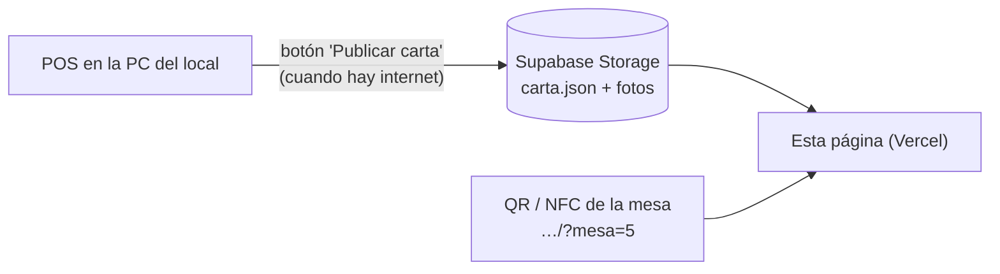

# Carta digital de AKROS Café

Página que abren los clientes al escanear el QR (o acercar el celular a la etiqueta NFC) de cada mesa.
Es estática (HTML, CSS y JS sin compilar): se publica tal cual en Vercel y lee la carta de un archivo `carta.json`
que publica el POS.



Si el local se queda sin internet, la carta sigue funcionando con la última versión publicada.
Si el que se queda sin señal es el cliente, ve la última carta que abrió en su celular, con un aviso.

## Probar en la PC

```bash
npm run dev     # http://localhost:4000/?mesa=5
npm test        # pruebas (node --test, sin dependencias)
```

`config.js` dice de dónde se lee la carta: por ahora `carta-ejemplo.json`, después la URL pública de Supabase.

## Formato de `carta.json` (versión 1)

Lo genera el POS: es el contrato entre el POS y esta página. Cambiarlo se avisa antes.

```json
{
  "version": 1,
  "negocio": "AKROS Café",
  "publicadaEn": "2026-10-25T18:30:00.000Z",
  "categorias": [
    {
      "id": 1,
      "nombre": "Cafetería",
      "productos": [
        { "id": 7, "nombre": "Cortado", "descripcion": "Con leche espumada", "precio": 1800, "imagen": "https://…/7.jpg" }
      ]
    }
  ]
}
```

- `categorias` ya viene **ordenada** (por `orden` del POS) y solo con productos **disponibles**.
- `precio` en **pesos** (como habla la API del POS), no en centavos.
- `imagen`: URL `https://` o vacía. Otra cosa se ignora y se muestra el ícono de AKROS.
- La página descarta productos sin nombre o sin precio, y categorías vacías, sin romperse.

## El link del QR

`https://<dominio-de-la-carta>/?mesa=N`. El número de mesa se muestra arriba y se va a usar en la etapa 2
(pedir desde la mesa). Las etiquetas NFC se graban con el mismo link (app *NFC Tools* → Escribir → URL).
